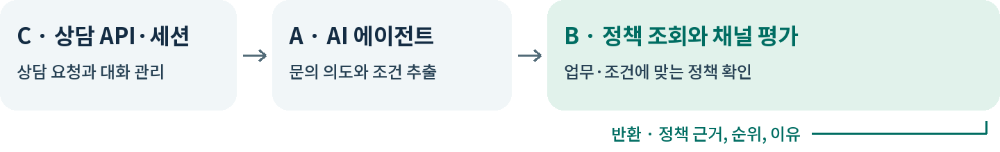

# 김은혜 | 사용자의 다음 단계까지 생각하는 사람

## 자기소개

Java와 Spring으로 백엔드를 공부하는 김은혜입니다. 사용자가 서비스를 이용하다 막혔을 때, 서버가 그 이유와 다음에 할 일을 안내하는 기능을 만드는 데 관심이 있습니다. WON길에서 상담 정보가 부족한 경우와 정책 조건에 맞지 않는 경우를 다뤄 보면서, 상황에 맞는 안내를 하려면 서버가 두 경우에 서로 다른 응답을 줘야 한다는 점을 배웠습니다.

## WON길 · AI 상담 채널 추천

| 항목 | 내용 |
| --- | --- |
| 행사 | 우리WON 청년 IT 아카데미 AX 해커톤 |
| 기간·팀 | 2026.10.26~10.28 · 3일 · B반 1팀, 5명 |
| 결과 | **우수상(개발 부문)** |
| 구현 상태 | 상담 채널 추천과 방법 안내를 구현한 해커톤 프로토타입 |

### 어떤 문제를 풀었나

자동이체 날짜 변경이나 카드 신고를 어디서 문의해야 할지 모르는 우리은행 고객을 대상으로 했습니다. 사전 미션에서 모은 금융 앱 리뷰 17건에서 본인확인 실패가 가장 많이 언급됐습니다. 팀 설문에서 문의 방법을 물었을 때 10명 중 7명은 전화, 3명은 앱 메뉴 검색을 선택했고 챗봇을 선택한 사람은 없었습니다. 팀은 고객이 문의 내용을 먼저 말하면 필요한 조건을 추가로 확인하고, 상황에 맞는 챗봇·전화·이메일과 추천 이유를 안내하는 흐름을 만들었습니다.

### 내가 구현한 정책 조회와 채널 추천

팀 프로젝트에서 **B파트의 정책 조회·채널 평가**를 맡았습니다. A파트가 사용자 문장에서 파악한 업무와 조건을 전달하면, 제가 구현한 서비스가 적용 가능한 정책과 채널 추천 결과를 반환합니다. C파트는 프런트의 상담 요청과 세션을 관리합니다.

초록색으로 표시한 B파트에 업무와 고객 조건이 들어옵니다. 출력은 **정책 안내 근거**와 **채널별 순위·추천 이유**입니다.

- **정책 조회** · 정책 JSON을 MySQL에 적재하고, 업무 유형·적용 기간·고객 조건·검증 상태로 정책을 찾았습니다. 예를 들어 자동이체 날짜 변경에 이체 구분이 빠져 있으면 `NEEDS_INFORMATION`과 누락 항목을 돌려줘 A파트가 추가 질문을 할 수 있게 했습니다.
- **채널 평가** · 각 채널에서 문의를 다룰 수 있는지 먼저 확인하고, 앱 이용 가능 여부·긴급성·실시간 문답 필요 여부 등을 기준으로 후보를 비교했습니다. 같은 정책·고객 조건·채널 운영정보가 들어오면 같은 순위와 이유를 반환하도록 구현했습니다.

**사용 기술** · Java 21과 Spring Boot 4로 정책·채널 서비스와 테스트를 구성했습니다. JPA와 MySQL을 정책 저장·조회에 사용했고, Gradle로 테스트를 실행했습니다. GitHub PR로 변경 코드와 검증 내용을 공유했습니다.

## 검증과 개선

### 어떤 조건에서 무엇을 확인했나

정책 조회·채널 평가 테스트, 정책 JSON 검증 테스트, MySQL 통합 테스트를 PR #2에 추가했습니다. 채널 추천은 시연용 정책과 채널 운영정보로 확인했습니다.

| 테스트 조건과 실행 방법 | 확인한 결과 |
| --- | --- |
| 자동이체 날짜 변경에서 이체 구분을 비우고 정책 조회 | `NEEDS_INFORMATION`과 누락 항목 `transferType` 반환 |
| MySQL의 타행 자동이체 정책으로 날짜 변경 방법을 조회하고, 앱 이용 가능 조건으로 채널 평가 | 챗봇을 1순위로 추천 |
| 같은 업무에 계좌별 확인과 실시간 상담이 필요한 조건을 넣어 채널 평가 | 전화만 추천 |
| 앱 이용이 어렵고 긴급하지 않으며, 나중에 답변을 받아도 되는 조건으로 채널 평가 | 이메일을 1순위로 추천 |
| 같은 정책·고객 조건·채널 운영정보로 채널 평가를 반복 | 점수·순위·추천 이유가 동일 |
| 정책 JSON의 안내 항목에 존재하지 않는 정책 코드를 넣어 파싱 | DB에 쓰기 전 예외 발생 |
| 이미 정책을 적재한 MySQL에 같은 JSON을 다시 적재 | `ALREADY_IMPORTED` 반환. 각 테이블의 행 수와 내용이 JSON과 일치 |

### 배운 점과 다음 검증

날짜 변경 문의에서 이체 구분이 빠진 경우와 확인된 조건이 정책에 맞지 않는 경우를 각각 테스트했습니다. 두 상황을 구분해서 반환해야 에이전트가 필요한 질문을 이어가거나 지원 범위를 안내할 수 있다는 점을 배웠습니다. 팀 협업에서는 담당 모듈의 입력·출력 예시와 조건별 응답을 먼저 합의하겠습니다.

**현재 한계** · PR #2의 검증 범위는 정책·채널 모듈입니다. 전화·이메일 운영정보와 일부 정책은 시연용이어서 실제 은행 운영에 그대로 적용하기 어렵습니다. 팀 프로토타입은 상담 방법과 목업 화면을 안내하며, 실제 상담 연결·예약·금융거래 실행은 구현 범위 밖입니다.

**다음 할 일** · 먼저 자동이체 변경 사례의 정책 근거, 적용 기간, 채널별 지원 범위를 공식 자료와 현업 검토로 확인하겠습니다. 확인된 정보를 테스트 데이터에 반영한 뒤, 지원 근거가 있는 채널만 추천되고 조건이 빠지면 추가 질문으로 이어지는지 통합 테스트로 검증하겠습니다.

### 코드와 테스트 근거

- [팀 백엔드 저장소](https://github.com/won-way/backend)와 [내 PR #2](https://github.com/won-way/backend/pull/2) · 팀 서비스 구조와 B파트 변경 사항
- [정책 조회 코드](https://github.com/won-way/backend/pull/2/files#diff-96159235f572efd3528949656c11e1f300bd02716641a1f37a7ecfef1dd3a25c)와 [채널 평가 코드](https://github.com/won-way/backend/pull/2/files#diff-9bcfb0d7de0c4e7f8ab69cbfddc970b0e1e38bb4b877c14bf64fba58b7ae5d55) · 적용 조건 확인과 순위 계산
- [정책 조회 테스트](https://github.com/won-way/backend/pull/2/files#diff-8d06a9486953bef6e5cc34747e8458312aec61a0bf06e9cd3f46aee30eac4bf8)와 [MySQL 통합 테스트](https://github.com/won-way/backend/pull/2/files#diff-461a1478cdee26ff32a81d8471f3cd3bf6596b56722d5e671ac3f699c517d823) · 누락 조건과 상황별 추천 검증
- [정책 JSON 테스트](https://github.com/won-way/backend/pull/2/files#diff-3d278e78ff1d707924e874d0782ab8e1062173eeab4adcd12b470a8cf04918c0)와 [MySQL 적재 테스트](https://github.com/won-way/backend/pull/2/files#diff-e8e8822f5038f32603d1c49ec8bd6e5479173b26f235a226e389ff037778cb8e) · 잘못된 참조와 중복 적재 검증
